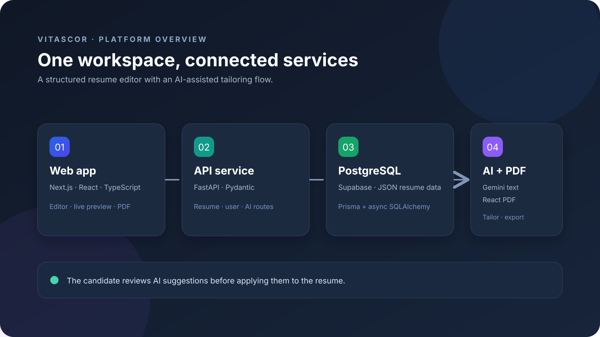
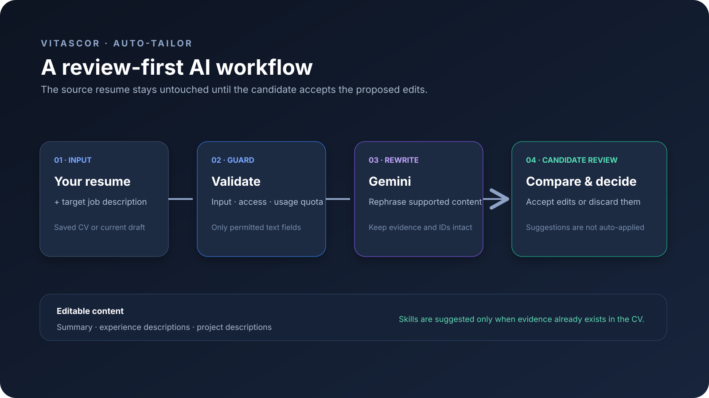
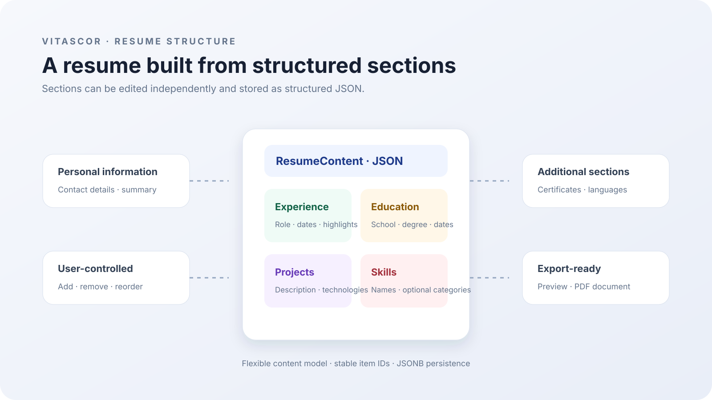
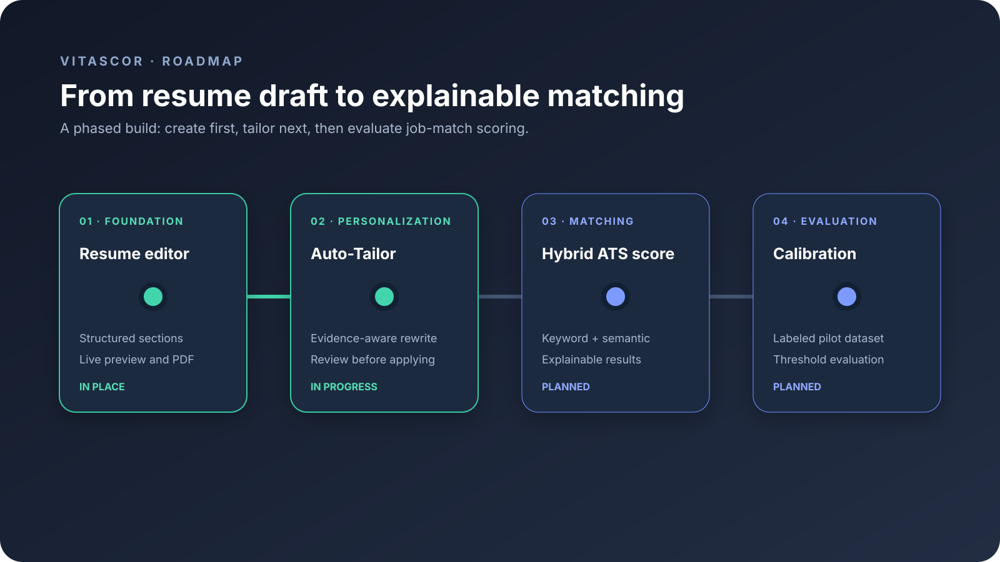
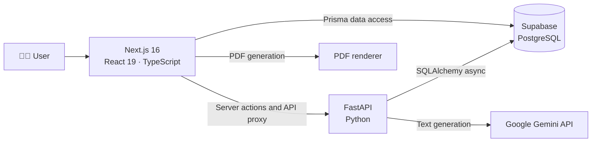
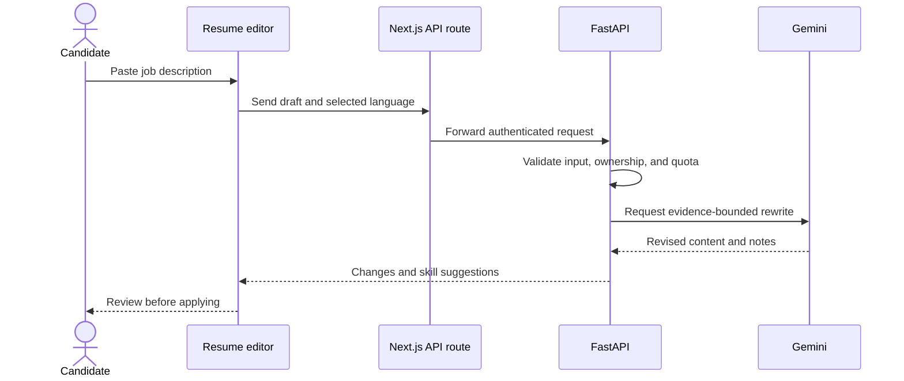
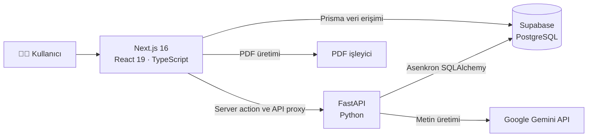
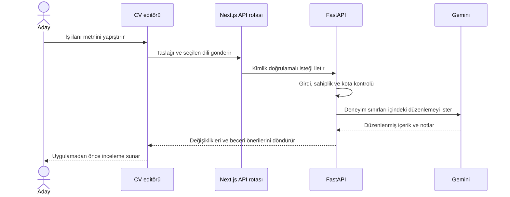

<div align="center">

# ✨ Vitascor

### A clearer resume. A more focused application.

An AI-assisted resume builder with structured editing, live preview, and job-specific rewriting that keeps the candidate's experience in bounds.

<p>
  
  
  
  
  
  
</p>

<p>
  <a href="https://sametbyrk.github.io/cv_bitirme/">🚀 Open the interactive project tour</a>
  &nbsp;·&nbsp;
  <a href="https://github.com/sametbyrk/cv_bitirme">View source on GitHub</a>
</p>

<p>
  <a href="#english">English</a> · <a href="#türkçe">Türkçe</a> ·
  <a href="#-what-vitascor-does">Features</a> ·
  <a href="#-architecture">Architecture</a> ·
  <a href="#-run-locally">Run locally</a> ·
  <a href="#-roadmap">Roadmap</a>
</p>

**Create · Refine · Apply**

</div>

<br />

<a id="english"></a>

## 🇬🇧 English

### 🎯 The idea

Vitascor helps job seekers create structured resumes and adapt their existing experience to a target job description. Its Auto-Tailor uses Google Gemini to rewrite selected resume text while preserving the source resume's facts and structure. Proposed changes are shown for review before they are applied.

The current release focuses on resume creation and AI-assisted tailoring. Hybrid ATS scoring is on the roadmap.

### ✨ What Vitascor does

| | Capability | What it means |
|---|---|---|
| 📝 | Structured resume editor | Add and manage experience, education, projects, skills, certificates, and languages. |
| 👀 | Live preview | Review the resume layout as you edit. |
| 📄 | PDF export | Generate a PDF with `@react-pdf/renderer` text components. |
| 🤖 | AI writing assistance | Improve supported resume fields and tailor a resume to a job description. |
| 🛡️ | Experience-aware rewriting | Keep changes within the supplied resume content; do not invent unsupported experience. |
| 🔎 | Change review | Compare suggested text with the current content, then accept or discard it. |
| 💡 | Evidence-based skill suggestions | Surface skills that already appear in the resume but are absent from its skills list. |
| 🌍 | Multiple resume languages | Choose a resume language for the editor and Auto-Tailor output. |

### 🖼️ Visual walkthrough

<table>
  <tr>
    <td align="center"><strong>🏛️ Platform architecture</strong><br /></td>
    <td align="center"><strong>✨ Auto-Tailor workflow</strong><br /></td>
  </tr>
  <tr>
    <td align="center"><strong>🧩 Resume data model</strong><br /></td>
    <td align="center"><strong>🗺️ Product roadmap</strong><br /></td>
  </tr>
</table>

### 🚀 Interactive prototype

Explore the diagrams in a small interactive project tour, with sections for the architecture, Auto-Tailor flow, resume model, and roadmap.

**[→ Open the Vitascor project tour ←](https://sametbyrk.github.io/cv_bitirme/)**

### 🏗️ Architecture



The frontend contains the resume experience and server-side routes. The FastAPI service provides resume, user, and AI endpoints. PostgreSQL stores user and resume records; resume content is modeled as structured JSON. Gemini is used for AI text generation.

### 🧰 Technology

| Area | Stack |
|---|---|
| Web | Next.js 16, React 19, TypeScript, Tailwind CSS |
| API | Python 3.12, FastAPI, Pydantic v2 |
| Persistence | Supabase PostgreSQL, Prisma, SQLAlchemy 2 async |
| AI | Google Gemini API |
| PDF | `@react-pdf/renderer` |
| Local development | Docker, Docker Compose |

### 🧭 Request flow



### 🚀 Run locally

#### Prerequisites

- [Docker Desktop](https://www.docker.com/products/docker-desktop/) with Docker Compose
- A PostgreSQL/Supabase project
- A Google Gemini API key for AI features

#### 1. Get the source

```bash
git clone <your-repository-url>
cd cv_bitirme
```

#### 2. Configure environment files

Docker Compose expects `backend/.env` and `frontend/.env`. Create these files on your machine and add the connection details for your own services.

`backend/.env`:

```dotenv
DATABASE_URL=postgresql://<user>:<password>@<host>:5432/<database>
SUPABASE_URL=https://<project-ref>.supabase.co
SUPABASE_JWT_SECRET=<shared-hs256-session-secret>
GEMINI_API_KEY=<google-ai-studio-api-key>
```

`frontend/.env`:

```dotenv
DATABASE_URL=postgresql://<user>:<password>@<host>:5432/<database>
JWT_SECRET=<same-shared-hs256-session-secret>
NEXT_PUBLIC_SUPABASE_URL=https://<project-ref>.supabase.co
NEXT_PUBLIC_SUPABASE_ANON_KEY=<supabase-anon-key>
```

For the current sign-in flow, `JWT_SECRET` and `SUPABASE_JWT_SECRET` must use the same HS256 secret. Docker Compose sets the frontend API address to `http://backend:8000/api/v1`.

#### 3. Start the development stack

```bash
docker compose up --build
```

| Service | Address |
|---|---|
| Web app | [http://localhost:3000](http://localhost:3000) |
| FastAPI docs | [http://localhost:8000/docs](http://localhost:8000/docs) |
| API health | [http://localhost:8000/health](http://localhost:8000/health) |

The Compose setup starts both services in development mode.

#### Publish the project tour

The repository includes a GitHub Actions workflow for the static tour in `docs/`. After pushing the repository, open **Settings → Pages** and set the source to **GitHub Actions**. The workflow publishes when changes to `docs/` reach `main`; the project tour will then be available at [sametbyrk.github.io/cv_bitirme](https://sametbyrk.github.io/cv_bitirme/).

### 🗺️ Roadmap

| Phase | Focus | Status |
|---|---|---|
| Now | Resume editor, PDF export, and reviewable Auto-Tailor suggestions | ✅ Complete |
| Next | Hybrid ATS scoring with rule-based and semantic matching |
| Later | Evaluation and calibration with a labeled resume/job dataset |

---

<a id="türkçe"></a>

## 🇹🇷 Türkçe

### 🎯 Proje fikri

Vitascor, iş arayanların yapılandırılmış özgeçmiş oluşturmasına ve mevcut deneyimlerini hedef iş ilanına göre uyarlamasına yardımcı olur. Auto-Tailor, Google Gemini ile özgeçmiş metinlerini yeniden düzenlerken kaynak CV’deki bilgileri ve yapıyı korumayı hedefler. Öneriler uygulanmadan önce kullanıcıya inceleme ve onay ekranında gösterilir.

Şu an özgeçmiş editörü ve Auto-Tailor üzerinde çalışılıyor. Hibrit ATS skorlama yol haritasında yer alıyor.

### ✨ Vitascor neler yapar?

| | Özellik | Açıklama |
|---|---|---|
| 📝 | Yapılandırılmış CV editörü | Deneyim, eğitim, proje, beceri, sertifika ve dil bölümlerini düzenleme. |
| 👀 | Canlı önizleme | Özgeçmiş görünümünü düzenleme sırasında inceleme. |
| 📄 | PDF dışa aktarımı | `@react-pdf/renderer` metin bileşenleriyle PDF oluşturma. |
| 🤖 | AI yazım desteği | Desteklenen CV alanlarını iyileştirme ve CV’yi iş ilanına uyarlama. |
| 🛡️ | Deneyim sınırlarını gözeten düzenleme | CV’de dayanağı olmayan deneyim ve bilgi üretmeme. |
| 🔎 | Değişiklik inceleme | Önerilen metni mevcut metinle karşılaştırıp kabul etme veya atma. |
| 💡 | Kanıta dayalı beceri önerileri | CV’nin başka bir bölümünde zaten bulunan, beceri listesine eklenmemiş ifadeleri önerme. |
| 🌍 | Çok dilli CV | Editör ve Auto-Tailor için CV dilini seçme. |

### 🏗️ Sistem mimarisi



Frontend özgeçmiş deneyimini ve sunucu tarafı rotaları içerir. FastAPI; CV, kullanıcı ve AI uç noktalarını sağlar. PostgreSQL kullanıcı ve özgeçmiş kayıtlarını tutar; özgeçmiş içeriği yapılandırılmış JSON olarak modellenir. Gemini, AI metin üretiminde kullanılır.

### 🧰 Teknolojiler

| Alan | Teknoloji |
|---|---|
| Web | Next.js 16, React 19, TypeScript, Tailwind CSS |
| API | Python 3.12, FastAPI, Pydantic v2 |
| Veri katmanı | Supabase PostgreSQL, Prisma, SQLAlchemy 2 async |
| Yapay zekâ | Google Gemini API |
| PDF | `@react-pdf/renderer` |
| Yerel geliştirme | Docker, Docker Compose |

### 🔄 İstek akışı



### 🚀 Yerel ortamda çalıştırma

#### Gereksinimler

- [Docker Desktop](https://www.docker.com/products/docker-desktop/) ve Docker Compose
- PostgreSQL/Supabase projesi
- AI özellikleri için Google Gemini API anahtarı

#### 1. Kaynak kodunu alın

```bash
git clone <github-depo-adresiniz>
cd cv_bitirme
```

#### 2. Ortam dosyalarını ayarlayın

Docker Compose, `backend/.env` ve `frontend/.env` dosyalarını bekler. Bu dosyaları kendi bilgisayarınızda oluşturup kullandığınız servislerin bağlantı bilgilerini ekleyin.

`backend/.env`:

```dotenv
DATABASE_URL=postgresql://<kullanici>:<parola>@<sunucu>:5432/<veritabani>
SUPABASE_URL=https://<proje-ref>.supabase.co
SUPABASE_JWT_SECRET=<ortak-hs256-oturum-gizli-anahtari>
GEMINI_API_KEY=<google-ai-studio-api-anahtari>
```

`frontend/.env`:

```dotenv
DATABASE_URL=postgresql://<kullanici>:<parola>@<sunucu>:5432/<veritabani>
JWT_SECRET=<ayni-ortak-hs256-oturum-gizli-anahtari>
NEXT_PUBLIC_SUPABASE_URL=https://<proje-ref>.supabase.co
NEXT_PUBLIC_SUPABASE_ANON_KEY=<supabase-anon-anahtari>
```

Mevcut giriş akışında `JWT_SECRET` ve `SUPABASE_JWT_SECRET` aynı HS256 anahtarını kullanmalıdır. Docker Compose, frontend API adresini `http://backend:8000/api/v1` olarak ayarlar.

#### 3. Geliştirme ortamını başlatın

```bash
docker compose up --build
```

| Servis | Adres |
|---|---|
| Web uygulaması | [http://localhost:3000](http://localhost:3000) |
| FastAPI dokümantasyonu | [http://localhost:8000/docs](http://localhost:8000/docs) |
| API sağlık kontrolü | [http://localhost:8000/health](http://localhost:8000/health) |

Compose ayarları iki servisi geliştirme modunda başlatır.

### 🗺️ Yol haritası

| Aşama | Kapsam | Durum |
|---|---|---|
| Şimdi | CV editörü, PDF çıktısı ve incelenebilir Auto-Tailor önerileri | ✅ Tamamlandı |
| Sırada | Kural tabanlı ve anlamsal hibrit ATS skorlama |
| Sonrasında | Etiketli CV/iş ilanı veri setiyle değerlendirme ve kalibrasyon |

---

<div align="center">

**Vitascor** · A resume editor that keeps the candidate in control.  
**Vitascor** · Adayın kontrolünü koruyan özgeçmiş editörü.

</div>
